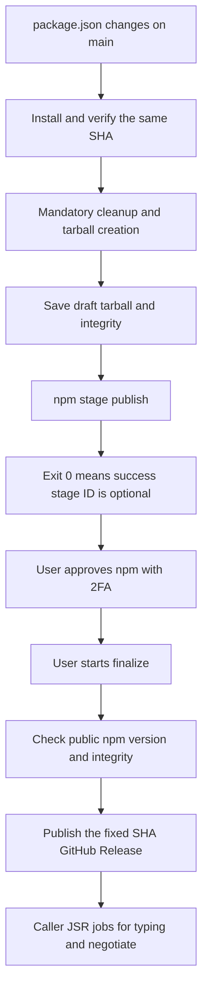

# Shared release workflow design

R1 is approved. The README and verification.md describe implementation details and R2 verification results.

The shared workflow provides mandatory cleanup and Node 26.x for all five repositories. It separates creating an npm staged package from publishing the GitHub Release after approval. Each caller retains its JSR job and connects it after finalize.

## R1 decisions

| Decision | Approved approach | Operational effect |
|---|---|---|
| npm approval period | Save a draft GitHub Release during stage; publish it through finalize after npm approval | GitHub Release is not public before npm approval |
| JSR timing | Publish after finalize; inspect JSR independently during retries | JSR waits for npm approval and can recover independently |
| Initial operation | A package.json change on main stages automatically; a person approves npm and starts finalize manually | One manual operation follows npm approval |

These change the previous publishing sequence. R1 approval precedes shared implementation and publishing configuration changes.

## Agreed requirements

- Use the public nlibjs/actions repository from nlibjs and gjbkz public/private callers.
- Use Node 26.x across release jobs and centrally pin npm 11.21.0.
- Require cleanup-package-json for all five packages. Its own release uses the built local CLI.
- Manage each repository's lint tools through devDependencies and a lockfile. Pin Biome where used; retain ESLint/Prettier in lint-commit. Call npm run lint.
- Retain consumer minimum Node versions, compatibility CI matrices, and repository-specific JSR CLIs.
- Pin shared workflow and action references to existing full commit SHAs.

## Layout and responsibilities

```text
nlibjs/actions/
├── .github/workflows/
│   ├── npm-release.yml
│   └── validate.yml
├── actions/
│   └── npm-release/
│       ├── action.yml
│       ├── package.json
│       ├── package-lock.json
│       └── src/
├── tests/
├── docs/tasks/t001-shared-workflows/
│   ├── plan.md
│   ├── design.md
│   └── record.md
├── examples/
└── README.md
```

The shared workflow owns state checks, tool versions, mandatory cleanup, npm staging, and GitHub Releases. A helper action shares its implementation and is not called directly by consumer repositories. Pin it as nlibjs/actions/actions/npm-release at an existing SHA: checking out the caller does not include files from the shared repository. [GitHub reuse concepts](https://docs.github.com/en/actions/concepts/workflows-and-actions/reusing-workflow-configurations)

Callers own events, concurrency, the workflow reference, npm scripts, and JSR jobs. Do not hardcode an owner or package name in the shared implementation; derive the target from github.repository and package.json. Validate the pinned helper/workflow combination when updating it.

Add shared Node CI at R6. R2 covers releases and validation of the implementation itself.

## Workflow interface

The default operation is verify. Publishing requires an explicit action. Do not expose arbitrary shell code, publishing destinations, cleanup disabling, or per-repository release Node versions.

| Input | Type and default | Meaning |
|---|---|---|
| action | string, verify | verify / stage / finalize; validate the enum before execution |
| version | string, empty | Required only for finalize; stable semver without a v prefix. Reject it for stage/verify |
| environment | string, empty | deployment or another caller environment; empty selects a job without an environment |
| cleanup-source | string, registry | registry / local; local uses the self-release esm/cli.mjs |

workflow_call has no choice input type, so the callee validates strings. [GitHub workflow syntax](https://docs.github.com/en/actions/reference/workflows-and-actions/workflow-syntax)

For stage/verify, pin source to github.sha and check out with fetch-depth: 0. stage/finalize accept only a main push or a workflow_dispatch on main, and reject publishing from pull requests/forks. finalize uses the full SHA stored in the Release target_commitish rather than rebuilding the selected latest main.

Pass free-form inputs through env, never directly into run scripts. Validate stable semver and enum values, then use quoted arguments. Prereleases, custom dist-tags, monorepos, and other registries are outside the initial interface.

| Output | Meaning |
|---|---|
| package-name / version / tag | Package identity and v-prefixed version tag |
| source-sha | stage/verify SHA or the Release target_commitish restored by finalize |
| npm-state | absent / staged / published / unknown; do not continue publishing on an unknown outcome |
| github-state | absent / draft / published |
| jsr-ready | String true only after successful finalize, including already-published Releases |
| release-url | Draft/published Release URL, empty for verify |

Do not use a single released boolean for all destinations. Gate JSR with jsr-ready, not tag existence.

## Publishing flow



Staging creates a pending package; human 2FA approval makes it public. Pending versions reserve the same version identity as published versions. OIDC cannot list pending packages or approve them. [npm staging](https://docs.npmjs.com/staged-publishing/), [npm-stage](https://docs.npmjs.com/cli/v11/commands/npm-stage/), [npm Trusted Publishing](https://docs.npmjs.com/trusted-publishers/)

### Verify

With read permission, run npm ci, npm run lint, npm test, and npm run build at the fixed SHA. If release:prepare exists, use it instead of build; that script must include building. After cleanup, inspect package.json and the tarball and summarize changes. Create no draft, tag, or npm stage.

Retain the existing multi-OS and multi-runtime test workflows. verify is a Node 26 release check and does not replace those checks.

### Stage

1. Read the version, tags, authenticated paginated Release list, and public npm version. Distinguish no-op from a new release. Never interpret communication/authentication failures as unpublished.
2. If no new-format draft exists and npm and the version tag are present, succeed as a no-op and summarize why. Do not require the tag to match current main: dependency-only changes legitimately advance main.
3. Without a draft, fail on one-sided npm/tag states or duplicate Releases. If a draft exists, do not re-stage; direct the maintainer to approval/finalize.
4. For a new version, run verification and mandatory cleanup. Require matching CHANGELOG notes and preserve name, version, dependencies, exports, bin, type metadata, and publishConfig.
5. Create one tarball with npm pack. Inspect its contents and integrity, then stage that exact tarball without rebuilding or repacking. Verify fixed CLI tarball input and provenance behavior during R2.
6. Create a draft with target set to the full source SHA. Save the tarball and integrity assets and confirm both before sending to npm. Include approval/finalize instructions in the body.
7. Treat exit code 0 from npm stage publish as success. Extract a stage ID when available as optional information, without failing if it cannot be extracted.

If staging exits nonzero and its registry outcome cannot be determined, stop with unknown state. If npm exits 0 but the GitHub body update fails, keep npm success in the log/summary. Distinguish this GitHub failure from an npm failure or missing stage ID. A retained draft prevents automatic resending.

npm-stage accepts a package-spec. Output parsing is only for the optional ID and does not decide success. [npm-stage input](https://docs.npmjs.com/cli/v11/commands/npm-stage/)

Pin the registry cleanup dependency in the helper's separate package.json/lockfile; do not install it into the caller manifest at runtime. Confirm that the selected version is public before R2. local uses the built esm/cli.mjs. Inspect the actual tarball after lifecycle scripts. Verify provenance with tarball input and use a consistent option across all packages.

### Finalize

1. Search all pages of the authenticated Release list by tag_name. Stop on no match or multiple matches, showing candidate IDs rather than selecting the newest.
2. Require full-SHA target_commitish. Read package identity and repository from the saved tarball and compare its actual integrity with the saved integrity file.
3. Match the public npm version and dist.integrity to the tarball. Pending approval, mismatches, and lookup failures leave the draft unpublished.
4. Resolve existing annotated tags to commits and compare with target_commitish. Never move an inconsistent tag.
5. Let GitHub create a missing tag when publishing the draft at the fixed target. Recheck the tag SHA afterward; do not add a separate tag-creation step.
6. An already-published Release with matching assets/tag/npm also succeeds and returns jsr-ready=true. Do not automatically modify historical Releases without the new assets.

finalize does not stage or rebuild. Complete assets before publication, including when immutable Releases are enabled. [GitHub CLI release behavior](https://cli.github.com/manual/gh_release_create), [GitHub Release API](https://docs.github.com/en/rest/releases/releases)

GitHub ignores target_commitish for tag creation when a tag already exists, so keep the explicit tag check. Require full SHAs rather than branch names in the drafts created by this implementation.

The current gh release view implementation also searches drafts. Use paginated list lookup here to detect duplicate matches, not because the CLI cannot read drafts. [GitHub CLI implementation](https://github.com/cli/cli/blob/trunk/pkg/cmd/release/shared/fetch.go)

### JSR

The typing/negotiate job checks out finalize's source-sha and prepares from the original package.json. Validate package/jsr metadata and tag, then use the existing CLI. The release:jsr contract is: publish if absent, otherwise verify the existing version's content/source and finish. Do not turn conflicts or communication errors into success.

Preserve typing's npx jsr flow and negotiate's Deno checks/publishing. Group repository-specific steps in scripts and add metadata checks to typing. Verify how to identify existing JSR content/source during R2/R4; unresolved conflicts require human inspection. [JSR publishing](https://jsr.io/docs/publishing-packages)

If JSR fails after GitHub publication, re-run finalize for the same version. It verifies state and returns jsr-ready=true again without re-staging npm or duplicating the GitHub Release.

## Initial persistence and retries

R2 does not implement a custom JSON schema or record restoration framework. Persist Release tag_name, full-SHA target_commitish, the tarball asset, and the integrity file. Restore package identity/repository from the tarball rather than duplicating identity/SHA fields in another record.

Keep the staging exit result, optional stage ID, and operation instructions in the summary/body. Do not require complete validation of schema-version, run ID, attempt, cleanup version, or stage ID. Keep the npm dist.integrity comparison.

| Existing state | Next operation |
|---|---|
| No public npm version, tag, or draft | Allow initial stage |
| Historical version without new assets, with public npm and version tag | Successful stage no-op with a reason |
| No draft, with only public npm or a tag | Fail as inconsistent; no automatic repair |
| Complete draft, awaiting npm approval | Do not resend; direct the maintainer to approval |
| Draft and public npm with matching integrity | Successful stage no-op; direct the maintainer to finalize |
| Draft with missing assets, staging failure, or unknown result | Do not resend; identify the state and required inspection |
| Published GitHub Release with matching assets/tag/npm | Successful finalize permitting JSR retry |
| Draft SHA differs from current main | Do not resend; finalize uses the draft SHA |
| Multiple draft/published Releases for one tag | Stop and show all candidate IDs |
| Inconsistent tag, tarball, version, or destination | Stop and show the difference |

Initial recovery is human inspection in npmjs.com and retrying finalize against the same draft. A missing stage ID does not prevent approval through the npm UI. Once npm is public and matches the saved tarball, finalize can recover a failure.

Do not automatically delete drafts and resend after an unknown outcome. Only after the user confirms no pending or public version exists, provide a procedure to resend the same saved tarball. Missing required assets prevent finalize.

Evaluate richer records, automatic unknown-outcome recovery, and scheduled finalize after R4. Create no schedule in this phase. Put manual instructions in the draft and summary to reduce forgotten finalization.

## Permissions and environments

| Job | GitHub permissions | Responsibility |
|---|---|---|
| Inspect / Verify | contents: read | Inspect, build, test, cleanup, and pack |
| Stage | contents: write, id-token: write | Draft/asset persistence, npm stage, and results in one job |
| Finalize | contents: write | Verify public npm and publish GitHub Release/tag |
| Caller PublishJsr | contents: read, id-token: write | JSR publishing |

Each caller job explicitly grants the operation's minimum permission ceiling. Shared publishing jobs inherit that ceiling; ValidateInputs and Verify explicitly reduce it to contents: read. Do not declare fixed write requests in shared publishing jobs: GitHub checks every nested job, including skipped ones, and rejects those requests for a read-only Verify caller. finalize does not need id-token and verify receives no write permission. [GitHub reuse permissions](https://docs.github.com/en/actions/reference/workflows-and-actions/reusing-workflow-configurations)

An empty environment selects a job without that property; otherwise select a protected job. Do not represent absence by creating an empty-name environment. Thin alternative jobs invoke the same helper. One Stage job handles all publishing steps, keeping protected approvals to one for stage and one for finalize. Independent verify needs no deployment approval.

On 2026-10-12, deployment in lint-commit and cleanup-package-json had empty protection_rules and null deployment_branch_policy. Neither currently requires environment reviewers. Retain the name to match npm authentication. This check changed no settings.

Public shared workflows can serve personal callers when their Actions settings allow them. Keep secrets in callers and pass them explicitly if needed. Add no npm token for public npm/OIDC. Private dependency authentication needs a separate design. [GitHub access rules](https://docs.github.com/en/actions/reference/workflows-and-actions/reusing-workflow-configurations)

Register the caller owner/repository/release.yml/environment with npm, not this shared repository. Grant id-token: write to the Stage caller and let the selected shared stage job inherit it, use GitHub-hosted runners, and retain disabled publishing dependency caches. [npm OIDC setup](https://docs.npmjs.com/trusted-publishers/)

Caller concurrency group release serializes stage/finalize/JSR, with cancel-in-progress=false. Do not add the same group to the callee. Default concurrency does not preserve every pending run in FIFO order; inspect unstaged versions and run stage manually if needed. [GitHub workflow syntax](https://docs.github.com/en/actions/reference/workflows-and-actions/workflow-syntax)

## Repository settings

| Repository | Environment | cleanup-source | JSR |
|---|---|---|---|
| changelog | None | registry | None |
| lint-commit | deployment | registry | None |
| cleanup-package-json | deployment | local | None |
| typing | None | registry | Existing JSR CLI after finalize |
| negotiate | None | registry | Existing Deno CLI/checks after finalize |
| gjbkz npm repository | Caller setting | registry | Separate job when needed |

Remove changelog's extra Biome install at R6 or in a separate small PR, not in the R3 release adoption PR. Restrict local cleanup to self-release. Compare cleanup-induced package content changes in every caller adoption PR.

## R2 and adoption verification

- Match caller inputs/outputs to the callee contract and validate pinned SHAs and permissions.
- Build/test all five repositories on Node 26 while retaining consumer compatibility checks.
- Verify registry/local cleanup and preservation of exports, types, dependencies, and bin.
- Test saved tarball staging input and provenance options with the fixed CLI.
- Verify successful same-version no-ops, exit 0 without an ID, and stopped resending on unknown nonzero outcomes.
- Exercise pending drafts, receipt update failures, duplicate drafts, GitHub failures, and independent JSR retries.
- Stop on communication failures and tag/integrity mismatches.
- Keep protected stage/finalize to one job each and confirm caller OIDC settings/required checks.
- Use fetch-depth: 0 for all five verify runs and tests requiring Git history.

Check workflow modification permission restrictions when finalizing a saved target whose workflow files differ from the current default branch. GitHub cannot grant that additional permission to GITHUB_TOKEN. Stop on relevant 403/404 errors rather than treating the Release as absent; agree on configuration/procedure in R2 rather than silently adding a long-lived token. [GitHub Release API](https://docs.github.com/en/rest/releases/releases)

R2 uses fixtures for side effects. Validate real OIDC and npm staging during changelog's normal release after R3.

## Responsibilities and review

Codex implements, validates, and revises. Claude performs technical review as specified in the supplied review. The user makes final decisions and shares review materials with Claude.

After R1 approval, the user creates public nlibjs/actions. Codex moves the plan/design/record and prepares the implementation PR for R2.

The user manages Trusted Publisher settings, environment rules, and npm 2FA approval. Provide exact settings and instructions before each task. The user starts the first finalize; Codex assists with execution/result verification within the approved scope.

The user approves and merges PRs after technical review. Do not publish packages or adopt the workflow in callers before R2/R3 approval. All nlibjs repository writing uses English.
