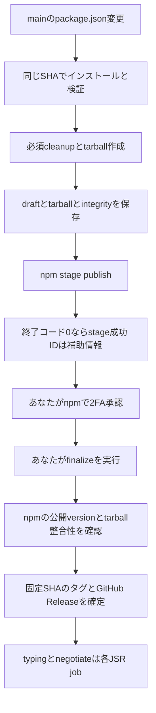

R1合意済み。R2実装時の詳細・検証結果はREADMEとverification.mdを参照。

# nlibjs actions 共通リリースの設計案

R1では、共通workflowの責務、呼び出し方法、npm承認後の公開順序を決める。採用案は、全5件でNode 26.xとcleanupを共通化し、npmの承認待ちを作る処理と、承認後のGitHub Release公開を分ける構成である。JSRは各repoのjobとして後段に接続する。

## R1で確認する事項

| 判断事項 | 採用案 | 運用への影響 |
|---|---|---|
| npm承認待ちの扱い | stage時にGitHubのdraft Releaseへ記録し、npm承認後にfinalizeで公開する | npm公開前にGitHub Releaseを公開しない |
| JSRの公開タイミング | finalize後。再実行ではJSRの状態を独立に確認する | npm承認前のJSR公開をやめ、JSRだけの失敗を回復できる |
| 初期の公開操作 | mainのpackage.json変更でstage。人がnpmを承認し、Actionsからfinalizeを手動実行 | 既存の自動stageに加え、承認後の操作が1回必要 |

この3点は既存の公開フローから変更になるため、R1の合意事項とする。共通workflowの実装・公開設定の変更はR1後に進める。

## 合意済みの前提

- 共通リポジトリは公開の `nlibjs/actions`。gjbkzの公開・非公開repoからも利用できるようにする。
- リリース用Nodeは全5件26.x。npmは既存の11.21.0を基準に共通側で固定する。
- cleanup-package-jsonは全5件に必須。自己公開だけビルド済みローカルCLIを使う。
- 各repoのlintツールはdevDependenciesとlockfileで管理する。Biome使用repoは完全固定版を使い、lint-commitのESLint/Prettierは維持する。共通workflowは `npm run lint` を実行する。
- 互換性CIのNode matrix、各packageの最低対応Node、JSR CLIの違いは維持する。
- 共通workflowと利用するactionsは実装時に実在する完全長SHAで固定する。

## 配置と責務

```text
nlibjs/actions/
├── .github/workflows/
│   ├── npm-release.yml           # verify / stage / finalize
│   └── validate.yml              # 共通基盤自身の検証
├── actions/
│   └── npm-release/              # workflow間で共有する処理
│       ├── action.yml
│       ├── package.json
│       ├── package-lock.json     # cleanupツールの固定依存
│       └── src/
├── tests/                        # 状態判定と回復のfixture
├── docs/tasks/t001-shared-workflows/
│   ├── plan.md
│   ├── design.md
│   └── record.md
├── examples/                     # 呼び出し例
└── README.md
```

共通workflowは、状態判定・ツール版・必須cleanup・npm staging・GitHub Releaseを担う。補助actionはその実装を共有し、利用repoから直接呼ばせない。共通workflow内でも補助actionを `nlibjs/actions/actions/npm-release@実在SHA` として固定する。callerのcheckoutには共通repoの補助ファイルが含まれないためである。[GitHubの再利用仕様](https://docs.github.com/en/actions/concepts/workflows-and-actions/reusing-workflow-configurations)

利用repoには、イベント、concurrency、共通workflowの参照SHA、npm scripts、JSR jobを置く。共通側にownerやpackage名を固定せず、操作対象は常に `github.repository` とソースのpackage.jsonから決める。共通repoの更新PRでは、補助actionの参照SHAとcallerが採用するworkflowのSHAの組み合わせも検証する。

Node CIの共通化はR6で追加する。今回のR2ではリリースと、その実装自体の検証に絞る。

## 共通workflowのinterface

通常のnpmパッケージは入力なしでもverifyとして呼べる。公開操作はactionを明示する。自由なシェルコード、任意の公開先、cleanup無効化、repoごとのNode版は入力にしない。

| 入力 | 型と既定値 | 意味 |
|---|---|---|
| action | string、verify | verify / stage / finalizeのみ。列挙値は実行前に検証する |
| version | string、空 | finalize時のみ必須。`1.2.3`の通常版のみ。prereleaseは初期対象外。stage/verifyで指定されたら失敗する |
| environment | string、空 | deploymentなど。空ならenvironmentを指定しないjobを使う |
| cleanup-source | string、registry | registry / localのみ。localは自己公開用 `esm/cli.mjs` を使う |

GitHubのworkflow_call入力にはchoice型がないため、calleeが文字列を検証する。[GitHubのworkflow構文](https://docs.github.com/en/actions/reference/workflows-and-actions/workflow-syntax)

stage/verifyのソースはcallerの `github.sha` に固定し、checkoutはfetch-depth: 0とする。stage/finalizeはmainからのpushまたはmainを選んだworkflow_dispatchに限定し、pull_requestやforkからの公開は受け付けない。finalizeでは選択した最新mainをビルドせず、draftの `target_commitish` に保存した完全長SHAを使う。

versionなどの自由入力は `run:` へActions式で直接挿入しない。env経由で渡し、通常版のsemverと列挙値を検証してから、引用した引数として扱う。初期版はprerelease、任意dist-tag、monorepo、別registryを対象外とする。

| 出力 | 意味 |
|---|---|
| package-name / version / tag | 対象パッケージと `v<version>` |
| source-sha | stage/verifyのSHA、またはfinalizeでReleaseのtarget_commitishから復元したSHA |
| npm-state | absent / staged / published / unknown。unknownは公開を継続しない |
| github-state | absent / draft / published |
| jsr-ready | 成功したfinalizeだけ文字列true。GitHub Releaseが既に公開済みでもtrueを返す |
| release-url | draftまたは公開済みReleaseのURL。verifyは空 |

`released`という1個のbooleanで全公開先の状態を表さない。JSR jobはjsr-readyを使い、タグの存在でskipしない。

## 公開フロー



stageが作るのは承認待ちで、npmへの公開は人の2FA承認で行われる。pendingも同じversionを占有する。OIDCではpending一覧の取得や承認を行えない。[npm staging](https://docs.npmjs.com/staged-publishing/)、[npm-stage](https://docs.npmjs.com/cli/v11/commands/npm-stage/)、[npm Trusted Publishing](https://docs.npmjs.com/trusted-publishers/)

### verify

read権限のみで、固定SHAの `npm ci → npm run lint → npm test → npm run build` を実行する。追加準備が必要なら `release:prepare` をbuildの代わりに使う契約とし、そのscriptはビルドを含む。cleanup後にpackage.jsonとtarballを検査し、変更内容をActionsのsummaryへ出す。draft・tag・npm stageは作成しない。

既存test.ymlの複数OS・複数ランタイム検証は維持する。verifyはNode26上の公開前検査であり、既存CI全体の代替ではない。

### stage

1. version、既存タグ、認証付きRelease一覧、npm公開versionを読み、no-opか新versionかを決める。通信失敗や認証エラーを「未公開」と解釈しない。
2. 新形式のdraftがなく、npm公開済みで同versionのタグがあるなら、成功のno-opとして終了する。summaryに「公開済みの同version」を表示する。現在のmainのSHAとの一致は求めない。依存更新だけでmainが進むのは正常だからである。
3. draftなしでnpmとタグの片方だけがある場合や、同tagのReleaseが複数ある場合は、食い違いを表示して失敗する。draftがある場合は再stageせず、承認またはfinalizeの案内を出す。詳細は再実行表による。
4. 未公開の新versionならverifyと同じ準備・検証を行う。CHANGELOGの該当節を確認し、必須cleanupを実行する。name、version、dependencies、exports、bin、型情報、publishConfigの保持を確認する。
5. `npm pack`でtarballを1回作り、配布ファイルとintegrityを検査する。同じtarballをstageし、再ビルド・再packしない。R2で固定npm CLIのtarball入力とprovenanceを検証する。
6. draft Releaseを `--target <source-sha>` で作り、tarballとintegrityファイルをassetへ保存する。両assetの保存を確認してからnpmへ送る。本文にはnpmの承認とfinalizeの手順を置く。
7. `npm stage publish <tarball>`の終了コード0をstage成功の基準にする。stage IDは取得できれば補助情報として本文とsummaryへ記録し、取得できなくても失敗にしない。

0以外で終了し、npm側の結果を確定できない場合はunknownとして止める。終了コード0の後にGitHub本文更新が失敗しても、npm staging自体は成功としてログ・summaryへ残す。これはGitHub側の保存失敗であり、stage IDのparse失敗やnpmの失敗とは区別する。draftが残るので、自動で再stageしない。

npm-stageはpackage-specを入力に取る。[npm-stageの入力](https://docs.npmjs.com/cli/v11/commands/npm-stage/)。CLIの出力は成功判定に使わず、IDの抽出は補助機能とする。

cleanupのregistry版は共通補助actionの独立したpackage.json/lockfileに固定する。利用repoのpackage.jsonやlockfileへ実行時に依存を追加しない。具体的なcleanup版はR2前にnpm公開済みを確認して決める。localならビルド済み `esm/cli.mjs` を使う。

pack前後のlifecycle scriptが配布内容を変えるrepoは、作成したtarballの検査結果を基準にする。tarball入力を含めprovenanceをR2で確認し、共通側の指定を全5件で統一する。

### finalize

1. 認証付きRelease一覧を全ページ取得し、指定versionのtag_nameでdraftと公開Releaseを探す。0件なら停止し、2件以上ならIDと状態を表示して人の確認を求める。最新のdraftを勝手に選ばない。
2. draftのtarget_commitishが完全長SHAであることを確認する。assetのtarballからpackage名・version・repositoryを読み、integrityファイルと実tarballのintegrityが一致することを確認する。
3. npmの公開versionとdist.integrityがtarballに一致するか確認する。承認待ち・不一致・取得失敗ならdraftのまま止める。
4. 既存タグがある場合はannotated tagも解決し、target_commitishと同じコミットを指すことを確認する。不一致のタグを移動しない。
5. タグがない場合の作成はdraftを公開するGitHub側の処理に任せる。target_commitishを固定SHAとして明示したまま公開し、公開後にタグの解決SHAを再確認する。別のタグ作成stepは置かない。
6. 既に公開済みでasset・タグ・npmが一致する場合も成功扱いにし、jsr-ready=trueとsource-shaを返す。新形式assetのない過去Releaseを通常finalizeで書き換えない。

finalizeはnpm stagingを実行せず、ビルドし直さない。Release公開後のasset更新を前提にしない。immutable設定がある場合でも、draft段階で必要なassetを揃える。[GitHub CLIのRelease仕様](https://cli.github.com/manual/gh_release_create)、[GitHub Release API](https://docs.github.com/en/rest/releases/releases)

GitHubのtarget_commitishは既存タグがあればタグ作成先に使われないため、タグの照合を省略しない。初期実装で作成するdraftは完全長SHAを使い、branch名が保存されているdraftは受け付けない。

Release一覧の採用理由は、draft取得と同tagの重複検出を一緒に行うためである。`gh release view`も現在のCLIではdraft検索を行うが、単一結果の取得だけでは重複検出の契約を満たさない。[GitHub CLIの実装](https://github.com/cli/cli/blob/trunk/pkg/cmd/release/shared/fetch.go)

### JSR

typing/negotiateに残すjobは、finalizeが返すsource-shaをcheckoutし、元のpackage.jsonで準備する。name/versionとjsr.json、タグを確認したうえで現行CLIを使う。JSR用 `release:jsr` scriptは「未公開なら公開、既存の同versionなら内容・公開元を照合して終了」の契約とする。既存versionの衝突や通信エラーを単に成功扱いにしない。

typingはnpx jsr、negotiateはDenoによる検証と公開を維持し、CLIと手順をscriptへまとめる。typingにもmetadata整合性チェックを追加する。既存JSR versionとソースの照合方法はR2/R4の実装・検証項目とし、証明できない衝突は人の確認を必要とする。[JSRの公開手順](https://jsr.io/docs/publishing-packages)

GitHub Release成功後にJSRが失敗した場合は、同versionでfinalizeを再実行する。共通側は整合性を確認してjsr-ready=trueを返すため、JSR jobが再び動く。npmを再stageせず、GitHub Releaseを重複作成しない。

## 初期実装の保存情報と再実行

R2では独自JSON schemaや記録復元機構を作らない。利用repoのdraft Releaseが持つtag_name、完全長SHAのtarget_commitish、tarball asset、integrityファイルを必要な保存情報とする。tarballからpackage名・version・repositoryを復元する。SHAやversionのための重複した記録assetは持たない。

stageの終了コード、取得できたstage ID、承認・finalizeの操作手順はsummaryとdraft本文に残す。stage ID、schema-version、run ID、attempt、cleanup版等の独自の完全性検証は必須にしない。npm registryのdist.integrityと保存tarballの照合は省略しない。

| 既存状態 | 次の操作 |
|---|---|
| npm公開なし、タグなし、同versionのdraftなし | 初回stageを許可 |
| 新形式assetなしの過去versionで、npm公開と同versionタグが両方ある | stageは成功のno-op。summaryへ理由を出す |
| draftなしでnpm公開だけ、またはタグだけが存在する | 不整合として失敗。自動修復しない |
| 完成したdraftがあり、npm承認待ち | stageは再送せず成功のno-op。承認を案内 |
| draftがあり、npm公開とintegrityが一致 | stageは成功のno-op。finalizeを案内 |
| draftがあるがasset不足、stage送信失敗、結果が不明 | 再送しない。状態と不足を表示して回復確認へ進む |
| GitHubも公開済みで新形式asset・タグ・npmが一致 | finalizeは成功し、JSRの再試行を許可 |
| draftのSHAと現在mainが異なる | stageは再送しない。finalizeはdraftのSHAを使う |
| 同tagのdraft/公開Releaseが複数ある | 停止し、全候補のIDを表示 |
| タグ、tarball、version、公開先の不整合 | 停止して差分を表示 |

初期の回復手順は、あなたがnpmjs.comでpendingと公開済みversionを確認することと、同じdraftを使ったfinalize再実行に絞る。stage IDを保存できなくても、npmの画面から承認できる。失敗の後にnpm公開済みとなれば、assetとintegrityが一致するdraftはfinalizeできる。

stage送信の成否が不明な状態では、draftを消して再送する自動操作をしない。npm側にpendingも公開versionもないとあなたが確認した場合に限り、同じ保存tarballの再送手順を案内する。tarballなど必須assetがない場合は公開確定を止める。

schemaを伴う履歴、結果不明からの自動回復、finalizeの定期実行はR4で必要性を判断する。定期finalizeはこの計画で作成しない。初期は本文とsummaryに手順を表示して、実行忘れを減らす。

## 権限とenvironment

| job | GitHub権限 | 実行する内容 |
|---|---|---|
| Inspect / Verify | contents: read | 読み取り、ビルド・テスト・cleanup・pack |
| Stage | contents: write、id-token: write | draft・asset保存、npm staging、結果表示を1jobで行う |
| Finalize | contents: write | npm公開確認、タグ、GitHub Release確定 |
| callerのPublishJsr | contents: read、id-token: write | JSR公開 |

calleeの実行jobは必要な権限だけを持つ。callerの呼出jobはその上限を渡す。finalizeにはid-token不要。verifyにもwrite権限を渡さない。[GitHubの権限と再利用](https://docs.github.com/en/actions/reference/workflows-and-actions/reusing-workflow-configurations)

environmentが空ならenvironmentなしjob、指定されたら保護付きjobを選ぶ。無指定を空文字environmentで表現せず、2種類の薄いjobから同じ補助actionを呼ぶ。draft作成、asset保存、npm staging、結果表示は1つのStage jobにまとめる。保護を追加した場合でもstageとfinalizeは各1回の承認に抑える。独立verifyにはdeployment承認を要求しない。

2026-10-12にlint-commitとcleanup-package-jsonのdeployment設定を読み取り、両方ともprotection_rulesは空、deployment_branch_policyはnullだった。現時点ではenvironmentの必須レビュアーによる承認はない。environment名はnpm認証との一致のため維持する。この取得は設定変更を伴わない。

publicな共通workflowは個人repoからも呼べるが、利用側のActions設定が許可している必要がある。secretsは共通repoへ集めず、必要ならcallerから個別に渡す。今回の公開npmとOIDCにはnpm tokenを追加しない。private依存がある個人repoは別途read token設計が必要なため初期例の対象外。[GitHubの利用制約](https://docs.github.com/en/actions/reference/workflows-and-actions/reusing-workflow-configurations)

npmには共通repoではなくcallerのowner/repo、release.yml、実行environmentを登録する。親子ともstage時にid-token: writeを付ける。GitHub-hosted runnerを使い、公開依存キャッシュは現行どおり無効にする。[npmのOIDC設定](https://docs.npmjs.com/trusted-publishers/)

concurrencyはcaller側の `release` でstage/finalize/JSRまで直列化し、cancel-in-progressはfalse。calleeには同じgroupを追加しない。既定concurrencyは全pending runのFIFO保存を保証しないため、複数versionの未処理stageはsummaryから確認し、必要なら手動stageする。[GitHubのworkflow構文](https://docs.github.com/en/actions/reference/workflows-and-actions/workflow-syntax)

## 各リポジトリの設定

| repo | environment | cleanup-source | JSR |
|---|---|---|---|
| changelog | 無指定 | registry | なし |
| lint-commit | deployment | registry | なし |
| cleanup-package-json | deployment | local | なし |
| typing | 無指定 | registry | finalize後に現行JSR CLI |
| negotiate | 無指定 | registry | finalize後に現行Deno CLIと検証 |
| gjbkzのnpm repo | そのrepoの設定 | registry | 必要な場合だけ独立job |

changelogの追加Biome install削除はR6または独立した小さなPRに分け、R3のリリース導入PRには含めない。cleanup-source=localは自己公開に限定する。cleanupによる配布package.jsonの変化は全repoの導入PRで比較する。

## R2以降の検証条件

- 例のcaller入力・outputsとcallee契約が一致し、SHA固定や権限に不足がない。
- Node26で全5件のbuild/testが動き、配布生成物は既存の対応Nodeでも動く。
- registry/local両cleanupが必須で、exports・型情報・依存・binが保持される。
- packした同じtarballをstageでき、provenanceが付く。固定npmの出力を解釈できる。
- 同versionの依存更新は成功no-op。stage IDなしでも終了コード0なら成功し、非0の結果不明では再送を止める。
- pending、npm成功後の本文更新失敗、重複draft、GitHub失敗、JSR失敗をfixtureで扱える。
- 通信失敗を未公開と誤認せず、既存タグ・npm integrityの不一致では止まる。
- stageの保護jobは1個で、finalizeも1個。npmのcaller認証設定と必須checkを導入時に確認する。
- fetch-depth: 0で5件のverifyを実行し、git履歴を使うテストも通る。

固定SHAのdraftを後日公開する経路では、GitHubのworkflow変更権限の条件も確認する。現行API仕様ではtarget commitのworkflowファイルが現在のdefault branchと異なる場合に追加権限が必要となり、GITHUB_TOKENではその権限を追加できない。該当する403/404をRelease未存在と解釈せず停止する。必要な設定・運用はR2で確定し、長期tokenを黙って追加しない。[GitHub Release API](https://docs.github.com/en/rest/releases/releases)

R2ではこれらの副作用を伴う経路をfixtureで検証する。実際のOIDCとnpm stagingはR3の確認後、changelogの通常の次回リリースで検証する。

## 担当と次のレビュー

実装・検証・修正はCodex、技術レビューは提示レビューで指定されたClaude、最終判断はあなたが担当する。Claudeへの資料共有はあなた経由で行う。

R1の最終合意後、あなたが公開repo `nlibjs/actions` を作成する。Codexが計画・設計・記録を移設し、共通実装と検証をPRにしてR2へ進める。

npm Trusted Publisher、必要なenvironmentの承認者・ルール、npmの2FA承認はあなたの作業とする。設定する値と操作手順は各作業の前に提示する。初回finalizeもあなたが開始し、その後は承認された範囲でCodexが実行・結果確認を支援する。

技術レビューはClaude、PRの最終承認・マージ判断はあなた、実装・検証・修正はCodexが担う。R2前にパッケージ公開や利用repoの導入を進めない。
